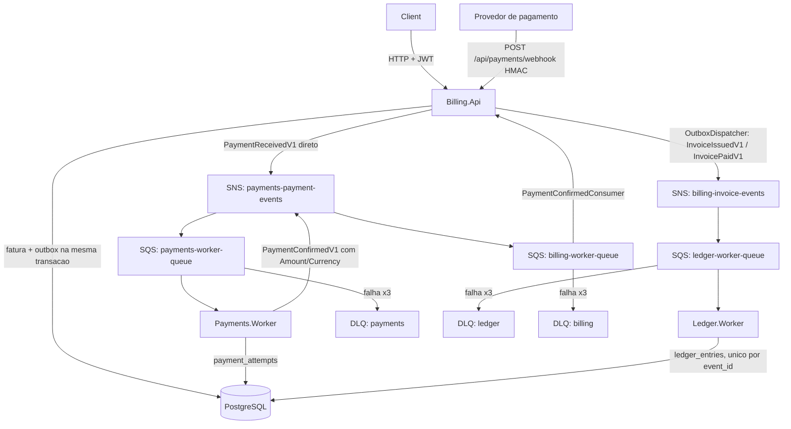

# BillingLedger

[](https://github.com/Lucasantunesribeiro/billing_ledger/actions/workflows/ci.yml)


Backend orientado a eventos para emissao de cobrancas (faturas), processamento de pagamentos e registro em ledger, em **.NET 9 / C#** com DDD, Outbox Pattern, idempotencia por `EventId` e mensageria via MassTransit (SNS/SQS na AWS ou LocalStack; `InMemory` nos testes).

## Visao Geral da Arquitetura



Topicos, filas e DLQs locais sao criados por `scripts/localstack-setup.sh`.

## Saga de Pagamento

```text
InvoiceIssued -> PaymentReceived -> PaymentConfirmed -> (valor e moeda conferem?) -> InvoicePaid -> Ledger CREDIT
```

- `InvoiceIssuedV1` gera um lancamento `Debit` no ledger; `InvoicePaidV1` gera um `Credit`.
- O Billing so marca a fatura como paga se o `Amount`/`Currency` do `PaymentConfirmedV1` baterem exatamente com a fatura. Pagamento parcial, excedente ou em outra moeda e registrado em `payments.payment_attempts`, a fatura continua `Issued` e um aviso e logado (conciliacao manual).
- O dominio tem a transicao `Issued -> Overdue` (`Invoice.MarkAsOverdue`), mas **nao ha job nem endpoint que a dispare** hoje.

## Catalogo de Eventos (V1)

| Evento                 | Publicado por                | Consumido por                     |
| ---------------------- | ---------------------------- | --------------------------------- |
| `InvoiceIssuedV1`      | Billing.Api (Outbox)         | Ledger.Worker                     |
| `PaymentReceivedV1`    | Billing.Api (webhook)        | Payments.Worker                   |
| `PaymentConfirmedV1`   | Payments.Worker              | Billing.Api (`PaymentConfirmedConsumer`) |
| `InvoicePaidV1`        | Billing.Api (Outbox)         | Ledger.Worker                     |
| `InvoiceOverdueV1`     | Billing.Api (Outbox), sem gatilho hoje | -                       |
| `LedgerEntryCreatedV1` | contrato definido, sem produtor | -                              |

Todos os eventos incluem `EventId`, `CorrelationId` e `SchemaVersion = 1`. `Currency` em `PaymentReceivedV1`/`PaymentConfirmedV1`/`LedgerEntryCreatedV1` e `Amount` em `PaymentConfirmedV1` sao campos opcionais adicionados de forma compativel ao V1.

## Dinheiro (ADR 0004)

- Todo valor monetario e `decimal` (nunca `double`/`float`), com moeda ISO 4217 explicita; ha teste que falha se surgir propriedade de ponto flutuante nos contratos/dominio.
- Colunas `numeric(18,2)` em `invoices`, `payment_attempts` e `ledger_entries` (teste verifica o mapeamento EF e que o modelo nao diverge das migrations).
- **Sem arredondamento implicito**: API, `Money.Of`, `PaymentAttempt` e `LedgerEntry` rejeitam valores com mais de 2 casas (`10.005` -> HTTP 400) e valores `<= 0`.
- Arredondamento so explicito via `Money.Round` (padrao `MidpointRounding.ToEven`, bancario).
- `Money.Allocate` rateia sem perder nem criar centavos (`100,00 / 3 = 33,34 + 33,33 + 33,33`).
- Contratos serializam `decimal` sem perda tanto no Outbox (`System.Text.Json`, numero) quanto no MassTransit (string JSON); coberto por testes de round-trip.

## Resiliencia de Integracoes

O `BillingLedger.Billing.Api` aplica resiliencia em dois pontos de saida:

- **Event bus outbound**: publicacoes feitas pelo `IEventBus` passam por retry exponencial com jitter, timeout por tentativa e circuit breaker antes de chegar ao transporte MassTransit/SNS/SQS.
- **HTTP outbound**: o projeto registra um `HttpClient` nomeado com `Microsoft.Extensions.Http.Resilience`, pronto para webhooks de saida e integracoes REST entre servicos ou workers quando esse fluxo for introduzido.

Em caso de falha transiente de rede, timeout curto ou indisponibilidade temporaria do broker/downstream, o comportamento esperado do `Billing.Api` e:

- tentar novamente operacoes transientemente falhas sem espalhar logica de retry pelos handlers;
- abrir o circuit breaker por uma janela curta quando houver sequencia de falhas;
- manter `retry`, `timeout` e `circuit breaker` configuraveis via `Resilience:EventBus` e `Resilience:DownstreamHttp`.

Exemplo de configuracao:

```json
"Resilience": {
  "EventBus": {
    "MaxRetryAttempts": 3,
    "BaseDelay": "00:00:00.250",
    "MaxDelay": "00:00:03",
    "AttemptTimeout": "00:00:10"
  },
  "DownstreamHttp": {
    "Retry": {
      "MaxRetryAttempts": 3,
      "Delay": "00:00:00.500",
      "BackoffType": "Exponential",
      "UseJitter": true
    },
    "CircuitBreaker": {
      "SamplingDuration": "00:00:30",
      "FailureRatio": 0.5,
      "MinimumThroughput": 5,
      "BreakDuration": "00:00:15"
    }
  }
}
```

## Schemas do Banco (PostgreSQL)

| Schema     | Responsavel      | Conteudo                       |
| ---------- | ---------------- | ------------------------------ |
| `billing`  | Billing.Api      | `invoices`                     |
| `payments` | Payments.Worker  | `payment_attempts`             |
| `ledger`   | Ledger.Worker    | `ledger_entries`               |
| `infra`    | Todos            | `outbox_messages`, `audit_logs`|

## Como Rodar Localmente

### Pre-requisitos

- Docker e Docker Compose
- .NET 9 SDK
- `awslocal` (`pip install awscli-local`) para interagir com LocalStack

> **Nota:** o Postgres do Docker usa a porta **5433** no host para evitar conflito com instalacoes locais na porta padrao `5432`.

### Atalho: setup automatico (Windows/PowerShell)

```powershell
.\tools\setup.ps1
```

Esse script sobe os containers, aplica todas as migrations e imprime os tokens JWT para teste.

### Setup manual

#### 1. Subir a infraestrutura

```bash
cp .env.example .env   # opcional: os defaults do compose ja servem para desenvolvimento
docker compose up -d   # postgres (porta 5433), redis e localstack (SNS/SQS)
```

Aguarde todos os healthchecks ficarem `healthy`, principalmente o LocalStack.

#### 2. Aplicar migrations EF Core

```bash
# Billing context
dotnet ef database update --project src/BillingLedger.Billing.Api

# Payments context
dotnet ef database update --project src/BillingLedger.Payments.Worker

# Ledger context
dotnet ef database update --project src/BillingLedger.Ledger.Worker
```

#### 3. Rodar os servicos

```bash
# Terminal 1 - API
dotnet run --project src/BillingLedger.Billing.Api

# Terminal 2 - Payments Worker
dotnet run --project src/BillingLedger.Payments.Worker

# Terminal 3 - Ledger Worker
dotnet run --project src/BillingLedger.Ledger.Worker
```

Swagger disponivel em `http://localhost:5082/swagger` (apenas em `Development`).

#### 3b. Alternativa: servicos .NET em containers

```bash
docker compose --profile app up -d --build
```

O profile `app` constroi `billing-api` (porta 5082), `payments-worker` e `ledger-worker` a partir dos Dockerfiles em `src/*/Dockerfile`, apontando para o Postgres e o LocalStack do proprio compose. As migrations **nao** sao aplicadas na subida: rode o passo 2 antes.

#### 4. Exemplo de fluxo completo

```bash
# 1. Criar invoice (draft)
curl -X POST http://localhost:5082/api/invoices \
  -H "Authorization: Bearer <token>" \
  -H "Content-Type: application/json" \
  -d '{"customerId":"00000000-0000-0000-0000-000000000001","amount":150.00,"currency":"BRL","dueDate":"2026-04-01"}'

# 2. Emitir invoice
curl -X POST http://localhost:5082/api/invoices/{id}/issue \
  -H "Authorization: Bearer <token>"

# 3. Simular pagamento recebido (webhook autenticado via HMAC-SHA256)
BODY='{"invoiceId":"{id}","externalPaymentId":"pix-abc123","provider":"PIX","amount":150.00}'
SIG="sha256=$(echo -n "$BODY" | openssl dgst -sha256 -hmac 'test-secret' | awk '{print $2}')"
curl -X POST http://localhost:5082/api/payments/webhook \
  -H "X-Webhook-Signature: $SIG" \
  -H "Content-Type: application/json" \
  -d "$BODY"
```

## Testes

Os projetos `BillingLedger.Ledger.UnitTests`, `BillingLedger.Payments.UnitTests` e `BillingLedger.IntegrationTests` sobem PostgreSQL via Testcontainers e precisam de Docker.

```bash
# Todos os testes
dotnet test BillingLedger.sln

# Apenas unitarios
dotnet test tests/BillingLedger.Billing.UnitTests

# Teste especifico
dotnet test --filter "FullyQualifiedName~Invoice_ShouldTransitionToPaid"

# Integracao (requer Docker)
dotnet test tests/BillingLedger.IntegrationTests
```

Testes focados em dinheiro e idempotencia:

```bash
# Escala, arredondamento, soma de muitas entradas e rateio com centavo residual
dotnet test tests/BillingLedger.Billing.UnitTests --filter "FullyQualifiedName~MoneyArithmeticTests"
# Round-trip decimal dos contratos (Outbox e MassTransit)
dotnet test tests/BillingLedger.Billing.UnitTests --filter "FullyQualifiedName~ContractDecimalSerializationTests"
# Reentrega do mesmo EventId nao duplica lancamento (PostgreSQL real)
dotnet test tests/BillingLedger.Ledger.UnitTests --filter "FullyQualifiedName~LedgerConsumerIdempotencyTests"
# Dois dispatchers do Outbox em paralelo publicam cada mensagem uma unica vez
dotnet test tests/BillingLedger.IntegrationTests --filter "FullyQualifiedName~OutboxConcurrentDispatchTests"
```

Teste unitario focado na resiliencia do barramento:

```bash
dotnet test tests/BillingLedger.Billing.UnitTests --filter "FullyQualifiedName~ResilientEventBusTests"
```

## Deploy gratuito (proposta)

Nao ha demo publica hoje e nenhum deploy foi configurado. Proposta sem custo e sem cartao, para o dono executar:

- **Billing.Api no Render** (free web service, runtime Docker, `src/BillingLedger.Billing.Api/Dockerfile`, contexto na raiz, `PORT=8080`, health check `/health`) + **PostgreSQL no Neon** (free).
- Variaveis: `ConnectionStrings__Postgres` (formato Npgsql com `SSL Mode=Require`), `Jwt__SigningKey` (32+ caracteres), `Payments__WebhookSecret`, `Messaging__Transport=InMemory`, `Swagger__Enabled=true`, `Database__MigrateOnStartup=true`.
- Token para o Swagger: `JWT_SIGNING_KEY=<mesma chave> JWT_ISSUER=billing-ledger JWT_AUDIENCE=billing-ledger-api dotnet script tools/gen-token.csx demo-user Finance`.
- Limite do modo de processo unico: sem Payments.Worker/Ledger.Worker, o webhook nao leva a fatura a `Paid` e nao ha lancamentos de ledger. Saga completa exigiria os workers (outros servicos) e um broker gratuito (ex.: CloudAMQP), o que pede trocar o transporte SQS do MassTransit.
- O modo demo foi validado localmente (Production + InMemory + Postgres local): `/health` 200, Swagger 200, migrations aplicadas na subida, fatura criada/emitida, `10.005` -> 400, webhook assinado -> 200. Plano free do Render dorme apos ociosidade.

## Deploy AWS (Milestone 3)

Consulte [`docs/runbook.md`](docs/runbook.md) para instrucoes completas de deploy, operacao e troubleshooting em producao.

```bash
cd infra
npm install
npx cdk bootstrap
npx cdk deploy --all
```

## Variaveis de Ambiente

Veja [`.env.example`](.env.example). Todas podem ser definidas como variaveis de ambiente (separador `__` para chaves aninhadas) e sobrescrevem o `appsettings.json`.

| Variavel                    | Uso                                                    |
| --------------------------- | ------------------------------------------------------ |
| `POSTGRES_USER/PASSWORD/DB` | Credenciais do Postgres no `docker-compose.yml`        |
| `ConnectionStrings__Postgres` | Conexao com o PostgreSQL (API e workers)             |
| `Jwt__SigningKey`           | Chave de assinatura dos tokens JWT (minimo 32 caracteres) |
| `Payments__WebhookSecret`   | Segredo HMAC-SHA256 do webhook de pagamentos           |
| `Database__User` / `Database__Password` | Opcional: credenciais anexadas a `ConnectionStrings__Postgres` (uso no ECS) |
| `Messaging__Transport`      | `SQS` para SNS/SQS; qualquer outro valor usa `InMemory` |
| `Messaging__LocalStackServiceUrl` | URL do LocalStack (ex.: `http://localhost:4566`); vazio = AWS real |
| `JWT_SIGNING_KEY`, `PAYMENTS_WEBHOOK_SECRET` | Repassadas pelo compose (profile `app`) para `Jwt__SigningKey` e `Payments__WebhookSecret` |
| `ASPNETCORE_ENVIRONMENT` / `DOTNET_ENVIRONMENT` | Ambiente dos servicos no profile `app` (padrao `Development`) |
| `Swagger__Enabled`          | `true` liga o Swagger fora de `Development` (demo) |
| `Database__MigrateOnStartup` | `true` aplica as migrations do schema `billing` na subida do Billing.Api (demo) |
| `Jwt__Issuer` / `Jwt__Audience` | Emissor/audiencia esperados no JWT (padrao `billing-ledger` / `billing-ledger-api`) |

Os valores em `appsettings*.json` e no `docker-compose.yml` sao apenas para desenvolvimento local; em producao use um gerenciador de segredos.

## Garantias do Ledger e Limitacoes

- **Append-only**: `LedgerEntry` nao tem setters publicos; so e criado via `LedgerEntry.Create`.
- **Idempotencia**: indice unico no `EventId` (`uq_ledger_entries_event_id`); reentrega do mesmo evento nao gera lancamento duplicado.
- **Dinheiro em `decimal`** (`numeric(18,2)` no banco), nunca ponto flutuante; `Amount` sempre positivo, o sinal vem do `Type`. `LedgerEntry.Balance` soma `Credit - Debit` e recusa mistura de moedas.
- **Trilha de auditoria**: tabela `infra.audit_logs`, alem do `CorrelationId` presente em todos os eventos.
- **Modelo atual**: uma fatura emitida gera um lancamento `Debit` e uma fatura paga gera um `Credit`. Nao ha partidas dobradas com duas pernas por transacao, endpoint de estorno nem consulta de saldo derivado; sao evolucoes pendentes.
- A idempotencia do ledger usa o `EventId` do evento, nao uma chave enviada pelo cliente HTTP. O `EventId` e gravado no payload do Outbox, entao uma republicacao (falha apos publicar e antes de marcar `published_at`) reaproveita o mesmo `EventId`.

### Limitacoes conhecidas

- **Dupla quitacao concorrente**: `Invoice` nao tem token de concorrencia. Dois `PaymentConfirmedV1` distintos (pagamentos externos diferentes) processados ao mesmo tempo para a mesma fatura podem ambos passar pela checagem `Status == Paid` e gerar dois `InvoicePaidV1` com `EventId`s diferentes, ou seja, dois `Credit`. A idempotencia por `EventId` nao cobre esse caso.
- **Confirmacao perdida no Payments.Worker**: se a publicacao de `PaymentConfirmedV1` falhar depois de gravar o `payment_attempt`, a reentrega cai na pre-checagem de duplicata e a confirmacao nao e republicada (nao ha Outbox nesse servico).
- Escala fixa de 2 casas: moedas com 0 ou 3 casas decimais nao sao suportadas corretamente.
- Nao ha conciliacao automatica de pagamento parcial/excedente, estorno, nem job de vencimento (`Overdue`).
- O dispatcher do Outbox mantem a transacao aberta durante a publicacao do lote (ate 20 mensagens, com os retries do `ResilientEventBus`).

## CI

O workflow `.github/workflows/ci.yml` roda em `push`/`pull_request` para `main` e `develop`: `dotnet format --verify-no-changes`, build Release, testes unitarios e de integracao (Testcontainers usa o Docker do runner) e, em job separado, `docker build` das tres imagens (sem publicar). Permissoes: `contents: read`.

## ADRs

- [0001 - Outbox Pattern](docs/adr/0001-outbox-pattern.md)
- [0002 - Idempotencia por EventId](docs/adr/0002-idempotencia-por-event-id.md)
- [0003 - Ledger append-only](docs/adr/0003-ledger-append-only.md)
- [0004 - Dinheiro em decimal: escala, moeda e arredondamento](docs/adr/0004-dinheiro-decimal-escala-e-arredondamento.md)

## Decisoes Arquiteturais

- **PostgreSQL schemas separados por BC**: um unico cluster RDS com schemas `billing`, `payments`, `ledger` e `infra`, mantendo isolamento logico sem overhead de multiplos bancos.
- **Outbox Pattern**: eventos publicados atomicamente na mesma transacao da mudanca de estado; o dispatcher seleciona com `FOR UPDATE SKIP LOCKED` dentro de uma transacao que so fecha depois de marcar `published_at`, entao instancias paralelas nao publicam a mesma linha.
- **MassTransit sobre SNS/SQS**: abstracao que permite `InMemory` em testes e `SQS` em producao via feature flag `Messaging:Transport`.
- **Resiliencia no Billing.Api**: `ResilientEventBus` protege publish outbound com retry exponencial, timeout e circuit breaker; `AddStandardResilienceHandler` prepara clientes HTTP para webhooks e callbacks de saida.
- **HMAC-SHA256 no webhook**: provedores externos autenticam via assinatura do payload; JWT nao e usado em endpoints de webhook.
- **Secrets Manager no ECS**: credenciais nunca em variaveis de ambiente em texto plano; sao injetadas via `secrets` no task definition.

## Threat Model (resumo)

| Ameaca               | Mitigacao                                                                      |
| -------------------- | ------------------------------------------------------------------------------ |
| Replay de pagamento  | Unique index `(provider, external_payment_id)` + idempotencia no handler       |
| Double spending      | Estado verificado antes de `MarkAsPaid` e valor/moeda conferidos; sem token de concorrencia (ver Limitacoes) |
| Spoofing de webhook  | Validacao de assinatura HMAC no endpoint `/payments/webhook`                   |
| Privilege escalation | JWT + RBAC via policies por endpoint; claims validados no middleware           |
| Exposicao de erros   | ProblemDetails sem stack trace em producao; logs estruturados internos         |
